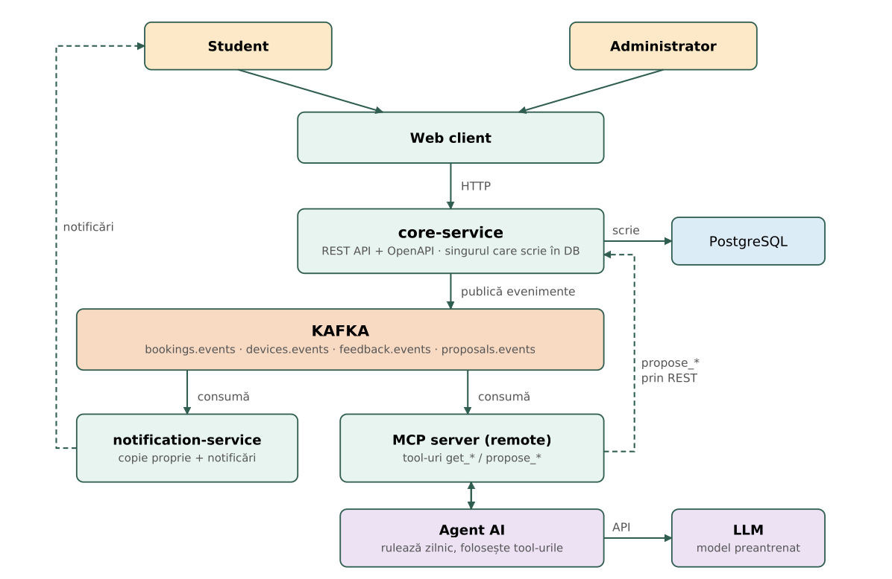

# Laundry Booking

A dorm laundry-room booking app built on an event-driven architecture (Kafka), with an AI agent that proposes maintenance actions and penalties.

> **Status:** in design (PCBE – Stage 2). The full project description (in Romanian) is in [`docs/Laundry_Booking_Prezentare.pdf`](docs/Laundry_Booking_Prezentare.pdf).

## The problem

Dorms have few washing machines and dryers. Students show up and find the machine busy or broken, some book a slot and never come, and the administrator has no clear picture of which machines break down often.

## The solution

Students book slots on machines and report faults. The app detects unfulfilled bookings (no-shows) and sends notifications. An AI agent analyzes faults and no-shows every day and **proposes** maintenance or penalties, which the administrator approves or rejects.

## Features

- book and cancel slots on washing machines and dryers
- report faults and send feedback
- no-show detection for unfulfilled bookings
- notifications for students
- AI agent that proposes actions, with final approval from the admin

**Out of scope:** no payments and no connection to real machines. Authentication is simple and all data is test data.

## Actors

| Actor | What they do |
|---|---|
| Student | Sees machines and free slots, books and cancels, confirms the start of a cycle, reports faults, sends feedback, receives notifications. |
| Administrator | Sees bookings, machines and faults, manages machines, approves or rejects the agent's proposals, reads the weekly feedback summary. |
| AI agent (automated) | Runs daily, reads faults and no-shows through MCP tools and creates proposals. It never approves or changes anything directly. |
| Notification system (automated) | Listens to Kafka events and sends notifications to students. |

## Architecture



- **core-service** is the only service that writes to the database (single source of truth) and publishes events to Kafka.
- **notification-service** and the **MCP server** build their own read copies from the events.
- The agent reads through MCP tools, and its proposals reach core-service through the REST API, where the admin approves them.

## Proposed tech stack

| Component | Technology |
|---|---|
| core-service | Java + Spring Boot |
| notification-service | Java + Spring Boot |
| MCP server | Java |
| AI agent | Python |
| Web client | React (React Native planned for the mobile app) |
| Database | PostgreSQL (accessed only by core-service) |
| Message broker | Apache Kafka |
| API | REST, documented with OpenAPI |
| AI | Pre-trained LLM used through an API, no custom training |
| Deployment | Docker and docker-compose, one container per service |

## Kafka events

| Topic | Events |
|---|---|
| `bookings.events` | `booking.created`, `booking.cancelled`, `booking.started`, `booking.noshow` |
| `devices.events` | `fault.reported`, `maintenance.opened`, `maintenance.closed` |
| `feedback.events` | `feedback.submitted` |
| `proposals.events` | `proposal.created`, `proposal.approved`, `proposal.rejected` |

## MCP tools

**Read**
- `get_device_errors(since, building)`
- `get_bookings(since)`
- `get_noshows(since)`

**Propose**
- `propose_maintenance(device_id, reason, severity)`
- `propose_penalty(user_id, reason)`

## Main flows

**Booking.** A student books a slot from the web client, core-service saves the booking and publishes `booking.created`. The notification-service receives the event, updates its own copy and schedules the notification.

**Daily agent run.** The agent calls the read tools for yesterday's faults and no-shows, groups them by machine and by student, and calls the propose tools. The admin sees the proposals in the dashboard and approves or rejects them, and the decision is published to `proposals.events`.

## Running the project

To be completed once the stack and project skeleton are decided.

```bash
# docker compose up
```

## Team

| Name | GitHub |
|---|---|
| Mates Anda-Maria | [@andamariamates](https://github.com/andamariamates) |
| Ille Vlad-Andrei | [@VladIlle](https://github.com/VladIlle) |
| Isfan Dragos-Andrei | [@Dragos-AndreiIsfan](https://github.com/Dragos-AndreiIsfan) |
| Marian Flavius-Andrei | [@FlaviusMarian27](https://github.com/FlaviusMarian27) |